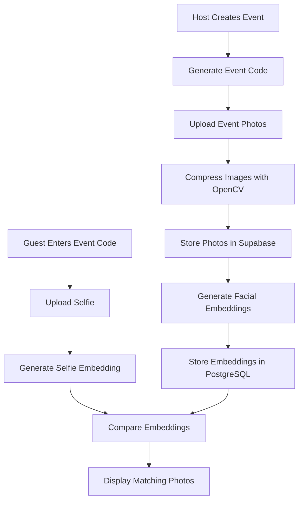

# 🎁 GiftGallery — AI-Powered Event Photo Platform

<p align="center">
  <b>Find your event photos with the power of AI.</b>
  <br>
  Upload a selfie, let AI match your face, and discover the event photos you're in.
</p>

<p align="center">
  
  
  
  
  
</p>

---

## 📌 Overview

**GiftGallery** is an AI-powered, full-stack web application that simplifies event photo sharing through facial recognition.

At traditional events, guests often need to scroll through hundreds or thousands of photographs to find the ones they're in. GiftGallery streamlines this process: guests join an event using a unique event code, upload a selfie, and receive a personalized gallery of matching photos.

The application combines facial embeddings, image compression, cloud storage, and database-backed similarity search to make event photo discovery easier.

## ✨ Key Features

| Feature | Description |
|---|---|
| 🤖 AI Facial Recognition | Uses DeepFace and the ArcFace model to generate facial embeddings and identify potential matches. |
| ⚡ Similarity Search | Stores 512-dimensional facial embeddings in PostgreSQL using pgvector for vector similarity search. |
| 📦 Image Compression | Uses OpenCV to resize and compress images before uploading them to cloud storage. |
| 🎟️ Event Codes | Allows guests to join the correct event using a unique event code. |
| 👤 Host Dashboard | Enables hosts to create events and upload event photographs. |
| 📸 Personalized Galleries | Helps guests find photographs that match their uploaded selfie. |
| ☁️ Cloud Integration | Uses Supabase Storage and PostgreSQL for photo storage and application data. |
| 🎨 Responsive Interface | Provides a responsive web interface using HTML, CSS, Bootstrap, and custom styling. |

## 🖥️ Application Screenshots


### 🏠 Welcome Page


The landing page introduces the platform and provides access to the event photo-sharing workflow.

### 📊 Host Dashboard


Hosts can create events, manage event codes, and upload photographs.

### 📷 AI-Powered Guest Gallery


Guests upload a selfie and browse the photos identified as potential matches.

## 🛠️ Tech Stack

| Category | Technologies |
|---|---|
| Programming Language | Python |
| Backend Framework | Flask |
| Facial Recognition | DeepFace, ArcFace |
| Face Detection | RetinaFace, where configured |
| Image Processing | OpenCV |
| Database | PostgreSQL |
| Vector Search | pgvector |
| Cloud Storage | Supabase Storage |
| Frontend | HTML5, CSS3, Bootstrap 5 |
| Icons | Font Awesome |
| Password Security | Werkzeug password hashing |
| Environment Configuration | python-dotenv |

## ⚙️ How It Works



1. **Event creation:** The host creates an event and receives a unique event code.
2. **Photo upload:** The host uploads event photographs.
3. **Image processing:** Images are resized and compressed before cloud storage.
4. **Embedding generation:** The application uses DeepFace with ArcFace to generate facial embeddings.
5. **Embedding storage:** The embeddings are stored in PostgreSQL using pgvector.
6. **Guest verification:** The guest joins the event and uploads a selfie.
7. **Similarity matching:** The application compares the selfie embedding with stored event-photo embeddings.
8. **Personalized gallery:** The application displays photos that satisfy the configured matching criteria.

## 🚀 Installation & Setup

### Prerequisites

Before getting started, make sure you have:

- Python installed
- Git installed
- A Supabase project
- A compatible Python environment for the project's machine-learning dependencies

### 1. Clone the Repository

```bash
git clone https://github.com/PrashantRohilla02/GiftGallery.git
cd GiftGallery
```

### 2. Create a Virtual Environment

**Windows:**

```powershell
python -m venv .venv
.venv\Scripts\activate
```

**Linux / macOS / WSL:**

```bash
python3 -m venv .venv
source .venv/bin/activate
```

### 3. Install Dependencies

Upgrade pip and install the required packages:

```bash
python -m pip install --upgrade pip
pip install -r requirements.txt
```

> **Note:** Machine-learning libraries such as TensorFlow and DeepFace may require a compatible Python version and operating-system dependencies. Follow the requirements for your environment if installation fails.

### 4. Configure Supabase

1. Create a project in [Supabase](https://supabase.com/).
2. Create a Storage bucket named `event_photos`.
3. Configure the bucket's visibility and access policies according to your application's security requirements.
4. Enable the pgvector extension in your database.
5. Create the required database tables if they do not already exist.

### 5. Set Up the Database

Open the Supabase SQL Editor and execute the following SQL for a fresh database setup:

```sql
CREATE EXTENSION IF NOT EXISTS vector;

CREATE TABLE users (
    id SERIAL PRIMARY KEY,
    username TEXT UNIQUE NOT NULL,
    password TEXT NOT NULL
);

CREATE TABLE events (
    id SERIAL PRIMARY KEY,
    event_name TEXT NOT NULL,
    event_code TEXT UNIQUE NOT NULL,
    host_id INTEGER REFERENCES users(id)
);

CREATE TABLE photos (
    id SERIAL PRIMARY KEY,
    filename TEXT NOT NULL,
    event_code TEXT NOT NULL,
    uploader_id INTEGER REFERENCES users(id)
);

CREATE TABLE photo_embeddings (
    id SERIAL PRIMARY KEY,
    photo_id INTEGER REFERENCES photos(id) ON DELETE CASCADE,
    embedding vector(512) NOT NULL
);
```

> **Important:** This schema is a starting point based on the application's described data model. If your existing database already contains these tables, do not recreate them blindly. Verify that the schema matches the queries in your current `app.py`.

### 6. Configure Environment Variables

Create a `.env` file in the project root directory:

```env
SUPABASE_URL=your_supabase_project_url
SUPABASE_KEY=your_supabase_api_key
DB_URI=your_postgresql_connection_string
SECRET_KEY=your_secure_random_secret
```

Replace the placeholder values with your own configuration.

- `SUPABASE_URL`: Your Supabase project URL.
- `SUPABASE_KEY`: The API key appropriate for your backend and configured Storage policies.
- `DB_URI`: Your PostgreSQL connection string.
- `SECRET_KEY`: A securely generated secret for Flask sessions.

**Security best practices:**

- Never commit `.env` to GitHub.
- Never publish your database password or secret/service-role API key.
- Configure Storage policies to allow only the required operations.
- Keep credentials out of source code and public logs.

### 7. Run the Application

With your virtual environment activated, run:

```bash
python app.py
```

Open the application in your browser:

[http://localhost:5000](http://localhost:5000)

If port `5000` is already in use, stop the existing Flask process before starting another instance.

## 📖 How to Use

### For Hosts

1. Register or log in.
2. Create a new event.
3. Generate an event code.
4. Upload event photographs.
5. Share the event code with guests.

### For Guests

1. Register or log in.
2. Enter the event code.
3. Upload a selfie.
4. Wait for the facial matching process.
5. Browse the resulting personalized gallery.

## 🔐 Security & Privacy

GiftGallery processes event photographs and facial embeddings, which can be sensitive personal data.

- Use secure password hashing.
- Protect session cookies and Flask secrets.
- Validate image formats, sizes, and uploaded content.
- Apply appropriate database permissions and Supabase Row Level Security policies.
- Restrict uploads and event access to authorized users.
- Obtain appropriate consent for facial recognition and photo processing.
- Avoid exposing private photographs or sensitive credentials through public URLs and logs.

## 🚧 Future Improvements

Potential areas for future development include:

- [ ] Background processing for large photo uploads.
- [ ] Pagination and optimized gallery loading.
- [ ] Improved face-matching threshold calibration.
- [ ] More comprehensive access controls for hosts and guests.
- [ ] Automated tests for authentication, uploads, and matching.
- [ ] Production deployment with secure environment configuration.
- [ ] Performance benchmarking using representative event datasets.

## 📄 License

This project is licensed under the **MIT License**. See the [`LICENSE`](LICENSE) file for details.

## 👨‍💻 Author

**Prashant Rohilla**

- GitHub: [@PrashantRohilla02](https://github.com/PrashantRohilla02)
- Project Repository: [GiftGallery](https://github.com/PrashantRohilla02/GiftGallery)

---

<p align="center">
  <b>🎁 GiftGallery — Find your moments, powered by AI.</b>
</p>
